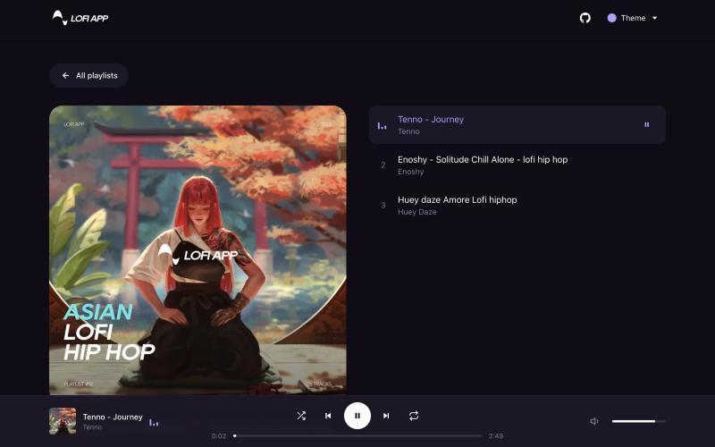

# Lo-Fi

A lo-fi music player for the web: browse playlists, play, shuffle and repeat, control it from the keyboard or your lock screen, and pick one of six colour themes. Built with **Next.js 16** (App Router, Cache Components) and **React 19**.



## Features

- **Playlists and a persistent player.** Music keeps playing while you move between pages. The player bar shows the track, transport controls, a seek bar and volume.
- **Shuffle and repeat** (off / all / one). Turning shuffle on or off never interrupts the track that's playing.
- **Auto-advance** to the next track, honouring shuffle and repeat. "Previous" restarts the current track when it's more than 3 seconds in, like most players.
- **Lock-screen and media-key controls** through the [Media Session API](https://developer.mozilla.org/docs/Web/API/Media_Session_API), with artwork, title and seek position.
- **Keyboard shortcuts:** <kbd>Space</kbd> play/pause, <kbd>←</kbd>/<kbd>→</kbd> seek 5 s, <kbd>Shift</kbd>+<kbd>←</kbd>/<kbd>→</kbd> previous/next, <kbd>M</kbd> mute. They're ignored while you type, and Space still activates a focused button.
- **Remembered preferences:** volume, mute, shuffle and repeat are saved in `localStorage`.
- **Six themes** (Lime, Cyan, Violet, Pink, Green, Light) with `next-themes` and no flash on load. Each theme's secondary text colour was adjusted to pass WCAG AA contrast (4.5:1).
- **Accessible controls:** labelled buttons, `aria-pressed` toggles, `aria-current` on the playing track, sliders that announce "1 minute 15 seconds of 2 minutes 44 seconds", a skip link, and reduced motion for the equaliser.
- **Fully static.** Every page is prerendered at build time; there's no backend to run.

## How it works

### Catalog

The catalog lives in [`data/catalog.data.ts`](data/catalog.data.ts) as typed data. The 2022 version fetched it from a GraphQL + Prisma backend on Heroku. When Heroku ended its free plans the backend and its database disappeared, and the app could no longer build. The playlists, tracks and artists were recovered from the last static deployment. Audio and artwork are hosted on Cloudinary.

Old links (`/playlist/<uuid>`) permanently redirect to the new readable slugs (`/playlist/popular-lofi-mix`); see `next.config.ts`.

### Player

```
lib/player/
  queue.ts       pure functions: play order, next/previous, shuffle, repeat (unit-tested)
  player.ts      the audio engine: one <audio> element, exposed as an external store
  hooks.ts       usePlayer, useCurrentTime, usePlayerShortcuts (useSyncExternalStore)
```

- **Queue logic is pure.** `queue.ts` knows nothing about audio or React. The play order is a permutation of track indices plus a position, so shuffling never reorders the playlist itself. That makes every rule testable in isolation.
- **One audio element, one store.** `player.ts` owns a single `HTMLAudioElement`, created on the client the first time it's needed. Components read it through `useSyncExternalStore`, so there's no context provider, and server rendering gets a stable initial snapshot.
- **Two channels.** The playback position changes several times a second, so it's published separately and only once per displayed second. Only the seek bar and progress line re-render while a track plays; the rest of the UI updates on real state changes.

## Getting started

Requires Node.js 20 or later.

```bash
npm install
npm run dev
```

Open http://localhost:3000.

| Script | What it does |
|---|---|
| `npm run dev` | Development server (Turbopack) |
| `npm run build` / `npm start` | Production build / server |
| `npm run lint` | ESLint (`next/core-web-vitals` + TypeScript rules) |
| `npm run typecheck` | `tsc --noEmit` in strict mode |
| `npm test` | Vitest unit tests for the queue logic and time formatting |

## Project structure

```
app/
  page.tsx                 playlists, featured artists, about
  playlist/[slug]/page.tsx playlist page (statically generated)
  globals.css              Tailwind v4 + the six theme palettes
components/
  player/                  player bar, transport, seek bar, volume
  playlist/                playlist card, track list, play button
  ui/                      button, slider (Radix)
  navigation.tsx, theme-menu.tsx, icons.tsx, logo.tsx
data/                      typed catalog + legacy URL redirects
lib/player/                queue logic, audio store, hooks
lib/format.ts              time formatting for display and screen readers
```

## History of the 2022 version

The original design and build are written up on my blog:

1. [Designing the brand identity](https://www.achrafgarai.com/making-a-music-app-part-1-branding/)
2. [Designing the UI](https://www.achrafgarai.com/building-a-music-app-part-2-ux-ui-design/)
3. [Building the back end with GraphQL, Prisma and Express](https://www.achrafgarai.com/building-a-music-app-part-3-back-end-with-prisma-and-apollo-server/)
4. [Building the front end with Next.js and Tailwind CSS](https://www.achrafgarai.com/building-a-music-app-part-4-building-the-frond-end-with-nextjs-and-tailwindcss/)

The back end from part 3 lives in [Lofi-Music-app-backend](https://github.com/AchrafGarai/Lofi-Music-app-backend). This version no longer depends on it.

## About me

I'm Achraf, a product designer and developer. Find me on [LinkedIn](https://www.linkedin.com/in/achraf-garai/), [Instagram](https://www.instagram.com/achraf_garai/) or [my blog](https://www.achrafgarai.com/).
